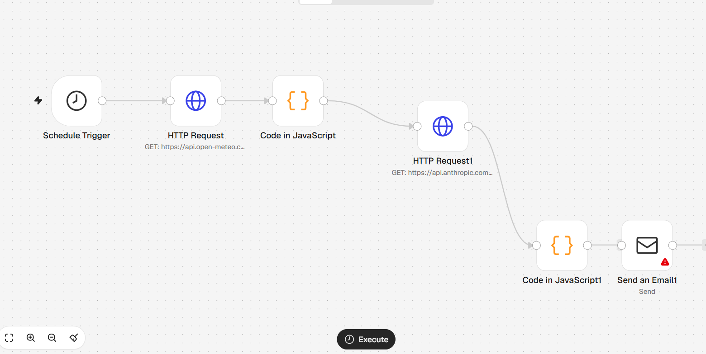

# Daily Weather Brief

An n8n automation that sends a daily morning email with a 5-day weather
forecast for Jerusalem, a chart, and an AI-written clothing recommendation.

## How it works
1. **Schedule Trigger** runs every day at 07:00 (Asia/Jerusalem).
2. **HTTP Request** fetches the forecast from the Open-Meteo API (no key needed).
3. **Code node** processes the data and builds a chart URL (QuickChart).
4. **HTTP Request** calls the Claude API to write a short, friendly recommendation in Hebrew.
5. **Code node** builds an RTL HTML email.
6. **Send Email (SMTP)** delivers it.

## Tech
n8n (self-hosted, Docker), REST APIs, JavaScript, Anthropic API, SMTP, QuickChart.

## Setup
1. Run n8n:
   `docker run -d --restart unless-stopped --name n8n -p 5678:5678 -v n8n_data:/home/node/.n8n docker.n8n.io/n8nio/n8n`
2. Import `workflow.json` (Workflows → Import from file).
3. Create credentials: SMTP (Gmail app password) and Header Auth (`x-api-key` for Anthropic).
4. Set the workflow timezone to Asia/Jerusalem and activate it.

## Notes
- Credentials are not included in the exported file.
- Replace the email addresses in the Send Email node with your own.
